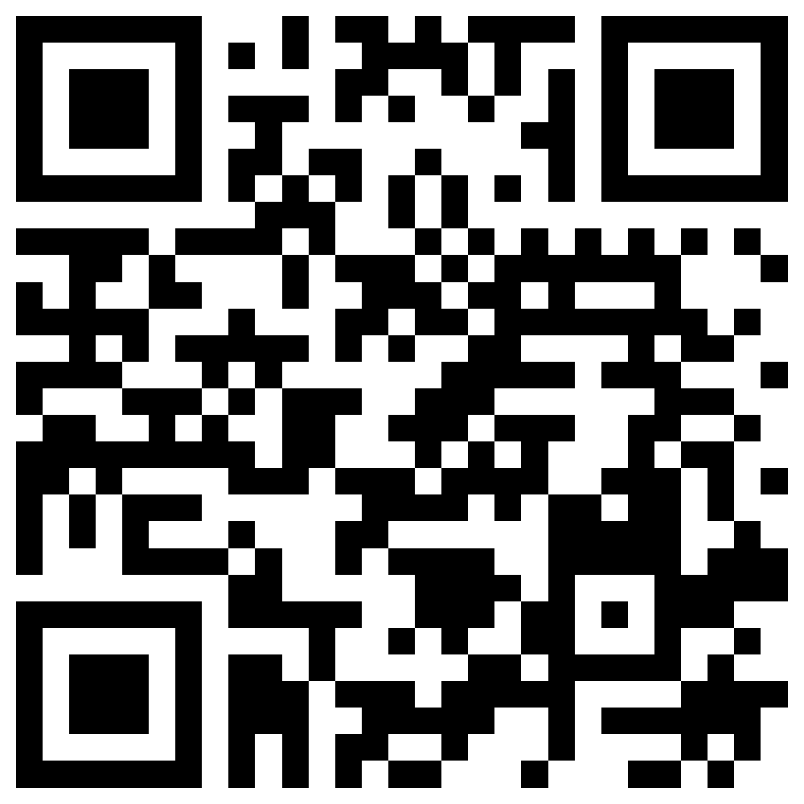

# 🛒 GoSelf — Soluções de Autoatendimento para Varejo

<p align="center">
  
  
  
</p>

<h3 align="center">
  <strong>Totem de Autoatendimento com Identificação Obrigatória de CPF, Pesagem Antifraude e Conciliação Instantânea</strong>
</h3>

<p align="center">
  <strong>Aluno:</strong> João A. Bernardo | <strong>Orientação:</strong> Prof. Kleber Kamers<br>
  <em>Curso Técnico em Desenvolvimento de Sistemas (TDESI) — SENAI Florianópolis / São José</em>
</p>

---

## 📱 Central Oficial & QR Code da Banca

Acesse todos os materiais, diagramas, protótipos e sistemas interativos pelo link oficial ou escaneie o QR Code abaixo com a câmera do smartphone:

👉 **[Acessar Central GoSelf Online](https://fettfuruke.github.io/GoSelf/)**

<p align="center">
  
  <br>
  <em>Escaneie com a câmera do celular para acessar os documentos e sistemas</em>
</p>

---

## 📌 Tabela Oficial de Links e Sistemas do Projeto

| # | Artefato do Projeto | Plataforma / Arquivo | Link Oficial de Acesso |
|---|---|---|---|
| 1 | 📊 **Apresentação Oficial (Pitch)** | Canva | [Abrir Apresentação no Canva](https://canva.link/llmqjqr6bnrnys4) |
| 2 | 🛒 **Totem Frente de Caixa (PDV)** | HTML5 / JS Interativo | [Abrir Totem Interativo](sistema.html) |
| 3 | 🏢 **Portal de Retaguarda (Admin)** | HTML5 / JS Corporativo | [Abrir Backoffice Admin](admin.html) |
| 4 | 📋 **Documento de Requisitos (v4.0)** | Google Docs | [Acessar Google Docs Oficial](https://docs.google.com/document/d/1PkzvR2z7BI21md1zqQHluUD_XUE5MJM5t1jo1gUhnaU/edit?tab=t.0) |
| 5 | 📐 **Diagramas UML Oficiais** | Google Drive | [Abrir Arquivo no Google Drive](https://drive.google.com/file/d/1yVvZs3HJW34IY5W-alrmPsHIEv3riV8Z/view?usp=sharing) |
| 6 | 🏗️ **Diagrama de Classes & Arquitetura** | Lucidchart | [Visualizar no Lucidchart](https://lucid.app/lucidchart/26cd1025-69d5-4dfe-84db-b1a770216da8/edit?viewport_loc=-2235%2C-1124%2C2658%2C1420%2C0_0&invitationId=inv_3a94cefa-3c38-4635-b2c4-1febaf1b8e10) |
| 7 | 🎨 **Protótipo de Telas & Wireframes** | Figma | [Acessar 30 Telas no Figma](https://www.figma.com/design/QGv99CJPnQ3PG4MsvMXCgs/GoSelf?node-id=0-1&t=f8Lg5noVuXJ0fcvj-1) |
| 8 | 💼 **Business Model Canvas** | Miro Board | [Acessar Canvas no Miro](https://miro.com/welcomeonboard/UFpKNFBhMjdNdURQVDBBZXlyYnQ0ZVFtWXBEeTU4ZzVCN3QxSXV6YnVpSHgrRWdoM0N1TE9qMUJtb3BjL0lBZXJjZ2F4VHp0TGwrV08vOERpSnJPcnQ2SjZNSFZMVEZWWTkvQlFOOFhNdmRmeVRZM21LNVA5Wk5VNFlybm9qSlpzVXVvMm53MW9OWFg5bkJoVXZxdFhRPT0hdjE=?share_link_id=345665069584) |

---

## 🎯 Proposta de Valor & Diferenciais Técnicos

O **GoSelf** foi desenvolvido para solucionar as duas maiores dores do varejo e cantinas corporativas:
1. **Filas nos Horários de Pico:** O autoatendimento permite checkout autônomo com navegação intuitiva em menos de 45 segundos.
2. **Prevenção Ativa de Perdas:** Diferente de caixas rápidos tradicionais onde há risco de troca de etiquetas, o GoSelf integra:
   - **CPF Obrigatório na Entrada (`RF-001` / `RN-002`):** Impede compras anônimas e garante rastreabilidade fiscal.
   - **Balança de Precisão Inviolável (`RF-014` / `RN-005`):** Conferência dinâmica item a item com tolerância restrita de $\pm 15g$ (Toledo Prix 3 Fit).
   - **Sinalização Andon e Desbloqueio Fiscal (`RF-020`):** Alerta em tempo real com liberação remota no painel de retaguarda ou via PIN físico no totem.
   - **Arquitetura Desacoplada (RBAC):** Portal administrativo separado com perfis para Fiscal de Loja, Responsável pelo Estoque, Técnico de Suporte TI e Administrador Geral.

---

## 📁 Estrutura de Arquivos do Repositório

```text
├── index.html                           # Central Oficial com QR Code e Acesso aos Links
├── sistema.html                         # Totem de Autoatendimento Frente de Caixa (PDV)
├── admin.html                           # Portal Corporativo de Retaguarda & Backoffice
├── goself-sync.js                       # Barramento de Sincronização em Tempo Real
├── qrcode_goself_alta_resolucao.png     # Imagem do QR Code Oficial em 1000x1000px
├── gerar_qrcode_local.py                # Utilitário para gerar novos QR Codes locais
└── README.md                            # Documentação principal do projeto
```

---

© 2026 João A. Bernardo | Curso Técnico em Desenvolvimento de Sistemas — SENAI
